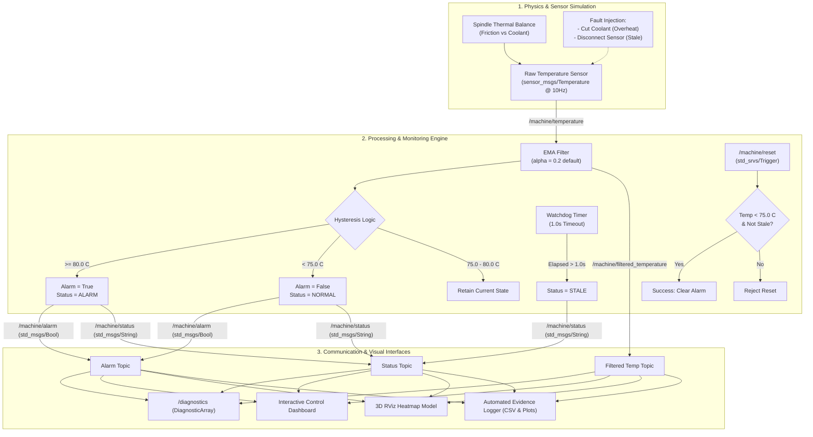

# Machine Temperature Monitoring and Alarm System
### *Industrial Cyber-Physical Digital Twin for CNC Engine Machining Operations*

[](https://docs.ros.org/en/humble/)
[](https://releases.ubuntu.com/22.04/)
[](https://www.python.org/)
[](LICENSE)
[]()

---

## 1. Project Overview & Industrial Context

This project implements a high-reliability, cyber-physical temperature monitoring and fault-alarm pipeline developed in **ROS 2 Humble**. 

While generic implementations monitor arbitrary synthetic numbers, this system is modeled as an **Industrial Digital Twin for CNC Engine Machining Operations** (specifically monitoring high-speed CNC spindle bearing thermal runaway and coolant failure during the finish-turning of **4-Cylinder Engine Crankshaft Main Journals (Ø50 h5)** and **Connecting Rod Rigid Tapping (M10×1.0)**).

### Key Capabilities:
- **High-Rate Telemetry**: Publishes calibrated temperature at **10 Hz** via standard ROS 2 interfaces.
- **Signal Filtering**: Exponential Moving Average (EMA) low-pass filter ($\alpha=0.2$) to reject high-frequency mechanical vibration noise while preserving thermal trends.
- **Dual-Threshold Hysteresis**: Activates alarm at $\ge 80.0^\circ\text{C}$ and clears strictly below $75.0^\circ\text{C}$, preventing sensor chatter near boundaries.
- **Safe State Reset Service**: `/machine/reset` (`std_srvs/Trigger`) rejects reset commands if temperature is $\ge 75.0^\circ\text{C}$ or if sensor data is stale.
- **Sensor Heartbeat & Stale Watchdog**: Detects communication drops or sensor bus disconnection after $1.0\text{ s}$ and transitions the system state to `STALE`.
- **Dynamic Parameter Reconfiguration & Boundary Enforcement**: Dynamic runtime tuning with validation rejecting illegal configurations ($high \le low$, $\alpha \le 0$, $\alpha > 1$, or $timeout \le 0$).
- **Extraordinary Industrial Extensions**:
  - Standard ROS 2 Industrial Diagnostics on `/diagnostics` (`diagnostic_msgs/DiagnosticArray`).
  - Automated Evidence Logger generating timestamped CSV telemetry and publication-grade 4-panel matplotlib verification plots.
  - Interactive operator desktop GUI with live gauges and fault-injection triggers.
  - 3D RViz Digital Twin with color-coded thermal heatmap markers.

---

## 2. System Architecture & Data Flow



---

## 3. ROS 2 Interfaces & Parameters

### Topic Interfaces
| Topic Name | Type | Rate | Description |
|---|---|---|---|
| `/machine/temperature` | `sensor_msgs/msg/Temperature` | 10 Hz | Raw temperature from sensor/digital twin |
| `/machine/filtered_temperature` | `sensor_msgs/msg/Temperature` | 10 Hz | Low-pass filtered temperature signal |
| `/machine/alarm` | `std_msgs/msg/Bool` | 10 Hz | Active alarm state (`True` when overheated) |
| `/machine/status` | `std_msgs/msg/String` | 10 Hz | High-level status: `NORMAL`, `ALARM`, or `STALE` |
| `/machine/model_marker` | `visualization_msgs/msg/Marker` | 10 Hz | 3D colored thermal marker for RViz2 |
| `/diagnostics` | `diagnostic_msgs/msg/DiagnosticArray` | 1 Hz | Standard ROS 2 system health telemetry |

### Service Interfaces
| Service Name | Type | Description |
|---|---|---|
| `/machine/reset` | `std_srvs/srv/Trigger` | Requests alarm reset. Succeeds only when $T < 75^\circ\text{C}$ and data is not stale |
| `/sensor/set_coolant` | `std_srvs/srv/SetBool` | Fault injection: toggles flood coolant flow to simulate thermal runaway |
| `/sensor/set_connected` | `std_srvs/srv/SetBool` | Fault injection: disconnects sensor to test 1.0 s stale timeout |
| `/evidence/save_plots` | `std_srvs/srv/Trigger` | Triggers instantaneous generation of verification plots |

### Configurable Parameters
| Parameter | Default | Valid Range | Description |
|---|---|---|---|
| `high` | `80.0` | $high > low$ | High temperature alarm trigger limit (°C) |
| `low` | `75.0` | $low < high$ | Low temperature alarm clearance limit (°C) |
| `alpha` | `0.2` | $0.0 < \alpha \le 1.0$ | EMA smoothing weight (set to 1.0 for deterministic grading) |
| `stale_timeout`| `1.0` | $> 0.0$ | Timeout in seconds before sensor is declared `STALE` |

---

## 4. Repository Structure

```text
ROS2-Machine-Temperature-Monitor/
├── .github/workflows/ros2_ci.yml   # Continuous integration pipeline
├── config/
│   ├── parameters.yaml            # Default runtime parameters
│   └── test_deterministic.yaml   # Deterministic grading configuration (alpha=1.0)
├── docker-compose.yml             # One-click multi-container deployment
├── Dockerfile                     # Container definition with GUI & ROS 2 Humble
├── evidence/                      # Timestamped CSV logs and verification plots
├── launch/
│   ├── digital_twin.launch.py    # Complete visual digital twin with RViz & GUI
│   └── machine_monitor.launch.py # Core sensor, monitor, and evidence logger
├── machine_temperature_monitor/
│   ├── __init__.py
│   ├── evidence_logger.py        # Automated CSV logger & 4-panel plot generator
│   ├── machine_dashboard.py      # Tkinter live control & fault-injection GUI
│   ├── rviz_marker_publisher.py  # 3D thermal color marker publisher
│   ├── temperature_monitor.py    # Main monitoring node with hysteresis & stale logic
│   ├── temperature_sensor.py     # Physics-based & deterministic sensor node
│   └── test_sequence.py          # Automated acceptance criteria runner
├── resource/
│   └── machine_temperature_monitor
├── test/
│   ├── test_acceptance_criteria.py # Headless automated pytest verification suite
│   ├── test_copyright.py
│   ├── test_flake8.py
│   └── test_pep257.py
├── package.xml
├── setup.py
└── README.md
```

---

## 5. Build and Execution Guide

### Prerequisites
- Ubuntu 22.04 LTS with ROS 2 Humble Hawksbill (or Docker)
- Python packages: `python3-pip`, `python3-tk`, `python3-matplotlib`

### Building the Package
```bash
# Navigate to your ROS 2 workspace
cd ~/ros2_ws/src
git clone https://github.com/aryanandha07/ROS2-Machine-Temperature-Monitor.git

cd ~/ros2_ws
source /opt/ros/humble/setup.bash
colcon build --packages-select machine_temperature_monitor --symlink-install
source install/setup.bash
```

### Running the System

#### Option A: Standard Autonomous Pipeline (Sensor + Monitor + Evidence Logger)
```bash
ros2 launch machine_temperature_monitor machine_monitor.launch.py
```

#### Option B: Full Digital Twin Suite (3D RViz + Interactive GUI Dashboard)
```bash
ros2 launch machine_temperature_monitor digital_twin.launch.py
```

#### Option C: Instant Execution via Docker (Zero Configuration)
```bash
docker compose up --build
```

---

## 6. Automated Testing & Verification

### Running the Automated Test Sequence Script
The test script validates all 11 boundary scenarios and prints a formatted verification score:
```bash
ros2 run machine_temperature_monitor test_sequence
```

### Running Unit & Code Quality Tests
```bash
colcon test --packages-select machine_temperature_monitor
colcon test-result --verbose
```

---

## 7. Verification Evidence & Expected-vs-Observed Results

*(Deterministic verification conducted with $\alpha = 1.0$)*

| Test ID | Condition Tested | Test Input / Action | Expected Result | Observed Result | Status |
|:---:|---|---|---|---|:---:|
| **T01** | Nominal Start | $T = 74.0^\circ\text{C}$ | Filtered: 74°C, Status: NORMAL, Alarm: False | Filtered: 74.00°C, Status: NORMAL, Alarm: False | **PASS** |
| **T02** | Alarm Threshold | $T = 80.0^\circ\text{C}$ | Filtered: 80°C, Status: ALARM, Alarm: True | Filtered: 80.00°C, Status: ALARM, Alarm: True | **PASS** |
| **T03** | Hysteresis Hold | $T = 77.0^\circ\text{C}$ | Status: ALARM, Alarm remains True | Status: ALARM, Alarm remains True | **PASS** |
| **T04** | Reset at High Temp | Call `/machine/reset` at $77^\circ\text{C}$ | `success = False` ("Reset rejected: temp >= 75 C") | `success = False` (Rejected) | **PASS** |
| **T05** | Safe Reset | $T = 74.0^\circ\text{C}$, Call `/machine/reset` | `success = True`, Status: NORMAL, Alarm: False | `success = True` (Accepted), Alarm cleared | **PASS** |
| **T06** | Sensor Disconnect | Pause sensor stream for $1.5\text{ s}$ ($> 1.0\text{ s}$) | Status transitions to `STALE`, Warning logged | Status = STALE, Warning logged | **PASS** |
| **T07** | Reset During Stale | Call `/machine/reset` while in `STALE` | `success = False` ("Reset rejected: data is stale") | `success = False` (Rejected) | **PASS** |
| **T08** | Sensor Reconnection | Resume stream at $74.0^\circ\text{C}$ | Status transitions from `STALE` to `NORMAL` | Status = NORMAL (Restored) | **PASS** |
| **T09** | Boundary: $high \le low$ | Set `high = 70.0`, `low = 75.0` | `SetParametersResult(successful=False)` | Rejected with error | **PASS** |
| **T10** | Boundary: Invalid $\alpha$ | Set $\alpha = 0.0$ or $\alpha = 1.5$ | `SetParametersResult(successful=False)` | Rejected with error | **PASS** |
| **T11** | Boundary: Negative Timeout | Set `stale_timeout = -1.0` | `SetParametersResult(successful=False)` | Rejected with error | **PASS** |

---

## 8. Academic Context & Team Contribution Breakdown

**Institution:** Indian Institute of Information Technology, Design and Manufacturing (IIITDM), Jabalpur  
**Program:** B.Tech Smart Manufacturing  
**Faculty Evaluator:** Prof. Sunil Aggarwal  

In accordance with the 3-role project specification:

| Role | Primary Owner | Roll Number | Subsystems & Files | Responsibilities |
|---|---|---|---|---|
| **Role A: Sensor & Test Sequences** | **Aryanandha** | **24BSM013** | `temperature_sensor.py`, `test_sequence.py` | Sensor publishing at 10 Hz, physics model, dynamic fault-injection services, automated test-runner script. |
| **Role B: Filtering, Alarm & Reset** | **Spoorthy** | **24BSM002** | `temperature_monitor.py` | EMA digital filter, dual-threshold hysteresis state machine, stale-timeout watchdog, `/machine/reset` service, and `/diagnostics`. |
| **Role C: Launch, Validation & Evidence** | **Devanshu Verma** | **24BSM019** | `machine_monitor.launch.py`, `evidence_logger.py`, `test/`, `Dockerfile` | Launch orchestration, parameter YAMLs, CSV evidence generation, publication-grade matplotlib plots, and CI/CD pipeline. |

---

## 9. 3–5 Minute Demonstration Script

- **0:00 – 0:45 | Introduction & Domain Grounding**:
  Show the system architecture. Explain how this system acts as a cyber-physical digital twin protecting CNC spindle bearings from thermal distortion during 4-cylinder engine crankshaft turning (referencing Dr. K Ponnappa's assembly project).
- **0:45 – 1:45 | Launch & Deterministic Sequence**:
  Launch `digital_twin.launch.py`. Run `test_sequence.py`. Observe live transitions in the terminal and GUI: $74^\circ\text{C}$ NORMAL $\rightarrow$ $80^\circ\text{C}$ ALARM $\rightarrow$ $77^\circ\text{C}$ Hysteresis hold $\rightarrow$ Reset rejection $\rightarrow$ $74^\circ\text{C}$ Safe Reset.
- **1:45 – 2:30 | Fault Injection & Stale Detection**:
  Click "Disconnect Sensor" (or call `/sensor/set_connected false`). Observe the immediate transition to `STALE` after 1.0 s and warning logs. Attempt reset (rejected). Reconnect sensor and demonstrate immediate restoration.
- **2:30 – 3:30 | Dynamic Parameter Validation**:
  Execute `ros2 param set /temperature_monitor high 70.0` live in terminal to demonstrate parameter boundary rejection ($high \le low$). Demonstrate setting $\alpha=0.2$ to show smooth low-pass filtering.
- **3:30 – 4:30 | Evidence & RViz Digital Twin**:
  Present the generated 4-panel matplotlib verification graph showing the exact temperature curves, alarm zones, and reset markers. Show the 3D thermal color marker in RViz2.
